# MPA — Módulo de Posición Angular

Planta didáctica del laboratorio de control de la **Universidad EIA** (Medellín), usada en el curso *Sistemas de Control en Tiempo Continuo* (Ingeniería Mecatrónica).

Una lámina de acrílico cuelga de un eje y la levanta el chorro de una hélice movida por un motor *brushless*. Un potenciómetro mide el ángulo. El objetivo del curso es identificar un **modelo en espacio de estados** alrededor de un punto de operación y, en el Reto 3, controlarlo por realimentación de estados con observador.

<p align="center">
  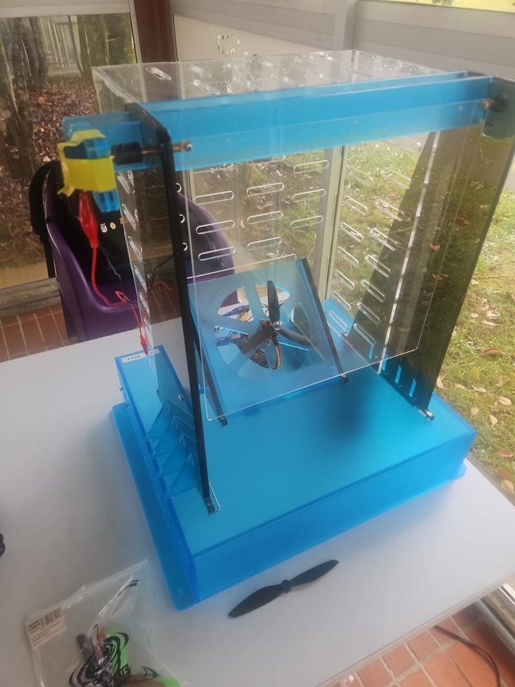
  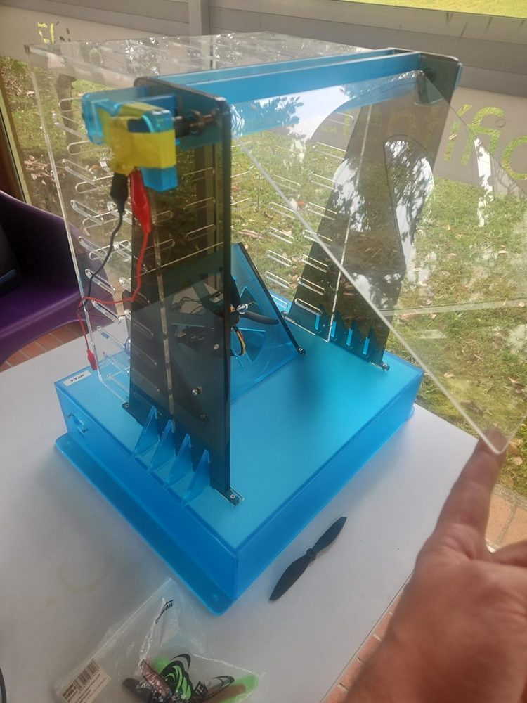
  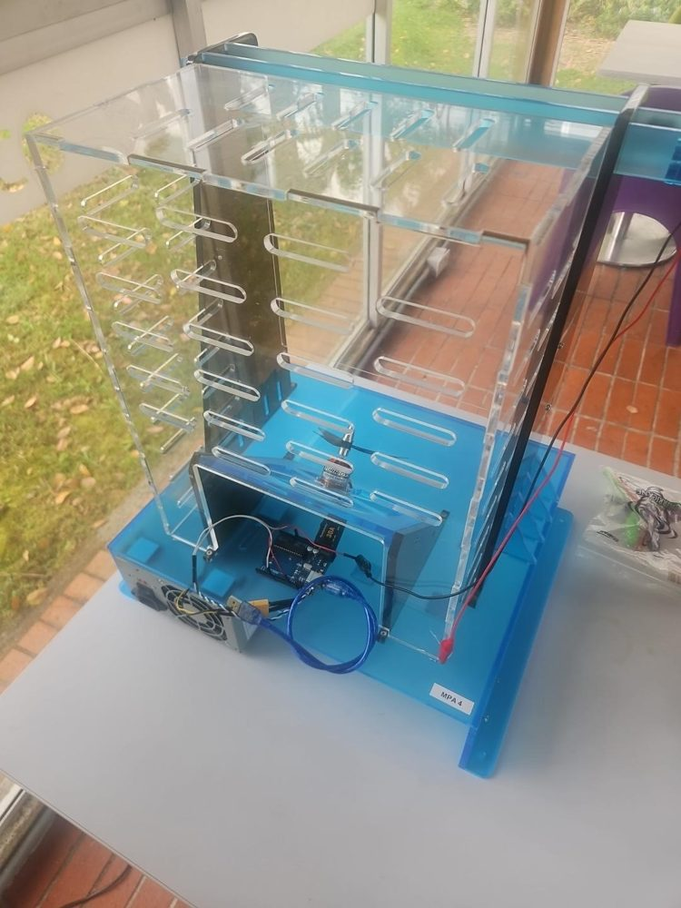
</p>

El procedimiento completo está en el **[manual (PDF)](manual/Manual_MPA.pdf)**. Este README es la guía rápida.

## Contenido

```
MPA-EIA/
├── firmware/MPA_Firmware/MPA_Firmware.ino   firmware que se graba en el Arduino (v2)
├── simulink/
│   ├── MPA_ensayos.slx   modelo de lazo abierto: subsistema MPA, calibración y registro
│   ├── parseMPA.m        MATLAB Function: decodifica la telemetría (22 bytes)
│   ├── packMPA.m         MATLAB Function: arma el comando (11 bytes)
│   └── latencia.m        MATLAB Function: diagnóstico de latencia
├── scripts/
│   ├── calibracion_sensor.m        calibración cuentas -> grados (guarda cal_MPAxx.mat)
│   ├── programa_escalera.m         mapa estático: programa del ensayo (antes del Run)
│   ├── analisis_escalera.m         mapa estático: análisis (después del Run)
│   ├── programa_identificacion.m   ensayo de pulsos y escalones
│   ├── analisis_pulsos.m           wn y zeta (matriz A)
│   ├── analisis_escalones_modelo.m K, matrices A, B, C, retardo y validación
│   └── alternativa_tfest.m         si la lámina no oscila
├── manual/               Manual_MPA.tex / .pdf y figuras
├── docs/                 figuras de este README
└── pruebas/              pruebas del protocolo con fallas inyectadas (PC, sin hardware)
```

## Qué usa cada uno

| Paso | Archivos |
|---|---|
| Montar y conectar la planta | `manual/Manual_MPA.pdf` (secciones 2 a 4) |
| Grabar el Arduino | `firmware/MPA_Firmware/MPA_Firmware.ino` |
| Hablar con la planta desde Simulink | `simulink/MPA_ensayos.slx`, con `parseMPA.m`, `packMPA.m` y `latencia.m` ya pegados en sus bloques |
| Calibrar el sensor | `scripts/calibracion_sensor.m` |
| Mapa estático | `scripts/programa_escalera.m` y `scripts/analisis_escalera.m` |
| Modelo en espacio de estados | `scripts/programa_identificacion.m`, `analisis_pulsos.m`, `analisis_escalones_modelo.m` (y `alternativa_tfest.m` si la lámina casi no oscila) |

El repositorio llega hasta el **modelo identificado de la planta**. El controlador, el observador y el lazo cerrado son trabajo de cada curso y no están aquí.

## 1. Conexiones

<p align="center">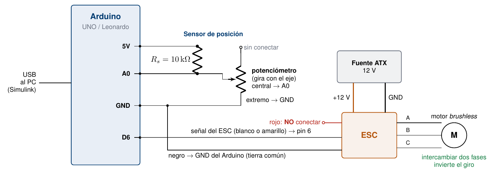</p>

- **Potenciómetro:** el terminal central va a **A0**, hay una resistencia de 10 kΩ de A0 a **5 V**, un extremo va a **GND** y el otro queda libre.
- **ESC:** señal (blanco o amarillo) al **pin 6**, negro a **GND** del Arduino (tierra común). El **rojo no se conecta**.
- **Potencia:** el ESC se alimenta de los 12 V de la fuente ATX. Al motor salen tres cables; **intercambiar dos cualesquiera invierte el giro**.

## 2. Grabar el firmware en el Arduino

1. Con la fuente del ESC **apagada**, conecta el Arduino por USB.
2. Abre [`firmware/MPA_Firmware/MPA_Firmware.ino`](firmware/MPA_Firmware/MPA_Firmware.ino) en el Arduino IDE (2.x o 1.8.x). La carpeta y el `.ino` deben llamarse igual. No hace falta instalar librerías: `Servo` viene con el IDE.
3. En **Tools → Board** escoge **Arduino Uno** o **Arduino Leonardo**, y en **Tools → Port** el COM del Arduino.
4. Revisa los parámetros al inicio del archivo:

   | Parámetro | Valor | Qué es |
   |---|---|---|
   | `PIN_ESC` | 6 | pin de la señal del ESC |
   | `PULSO_0` | 1000 µs | `u = 0 %`: motor detenido y armado del ESC |
   | `PULSO_100` | 1450 µs | `u = 100 %`: máxima velocidad útil (ajustar por unidad) |
   | `PULSO_TOPE` | 1450 µs | ningún pulso lo supera |
   | `RAMPA_PCT_S` | 50 %/s | rapidez máxima de cambio del mando (protege la fuente) |
   | `TIMEOUT_MS` | 200 ms | sin comandos válidos, el mando baja a 0 |

5. Pulsa **Upload**. Debe terminar con «Done uploading».
6. **Cierra el monitor serie** antes de abrir Simulink, porque ocupa el puerto. Si lo abres solo verás símbolos raros: los paquetes son binarios.

> ⚠️ No abras un modelo de la MPA en **Connected IO** ni en **Run on board**: Simulink reemplaza este firmware por el suyo y hay que volver a grabarlo. Conviene pegar en cada unidad el rótulo «Firmware MPA v2».

<p align="center">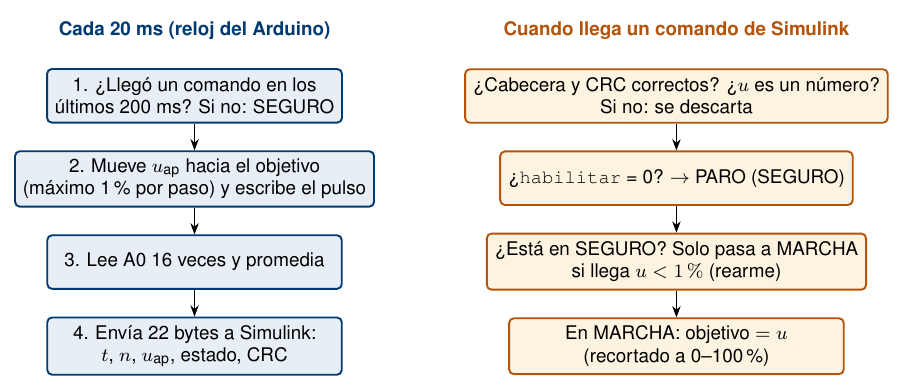</p>

## 3. El subsistema MPA en Simulink

Se necesita el **Instrument Control Toolbox**. No hace falta el *Support Package for Arduino*.

<p align="center">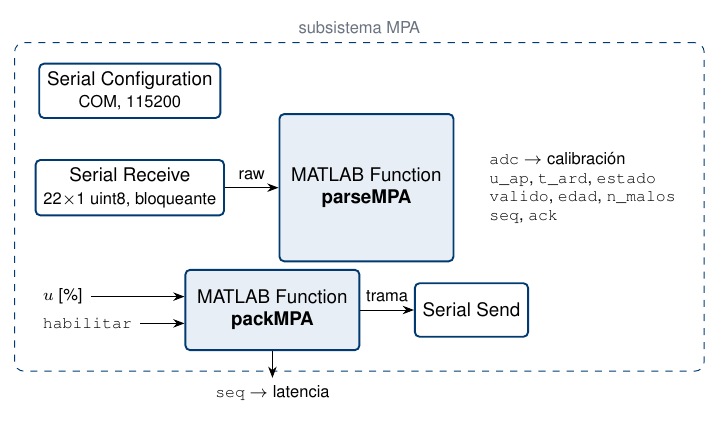</p>

| Bloque | Configuración |
|---|---|
| Serial Configuration | COM de la unidad, 115200, 8N1, sin control de flujo, Timeout 5 s |
| Serial Receive | Header vacío, Terminator `<none>`, Data size `[22 1]`, `uint8`, **Enable blocking mode**, **Block sample time 0.02** (con 0.01 el tiempo de Simulink avanza a la mitad del real) |
| MATLAB Function | contenido **completo** de `parseMPA.m` (con sus funciones auxiliares) |
| MATLAB Function | contenido **completo** de `packMPA.m` (entradas `u` [%] y `habilitar` 0/1) |
| Serial Send | Header vacío, Terminator `<none>` |
| Solver | paso fijo, `ode4`, 0.02 s; **sin Simulation Pacing**; Hardware board `None` |
| Data Import/Export | **Single simulation output desmarcado** y *Time* (`tout`) marcado: cada *To Workspace* deja su variable suelta en el workspace |

**Por qué no hace falta Simulation Pacing:** el Arduino envía un paquete cada 20 ms con su propio reloj, y el *Serial Receive* bloqueante deja avanzar a Simulink un paso por paquete. El tiempo de simulación es, entonces, el tiempo real.

**Arranque:**
1. Con la fuente apagada, Run con `u = 0` y `habilitar = 1`.
2. Verifica `estado = 1`, `valido = 1` y latencia 0 o 1.
3. Enciende la fuente.

Después de un PARO o de un corte de comunicación, el motor solo vuelve a arrancar cuando recibe `u < 1 %`.

## 4. La hélice: el aire debe ir hacia la lámina

<p align="center">
  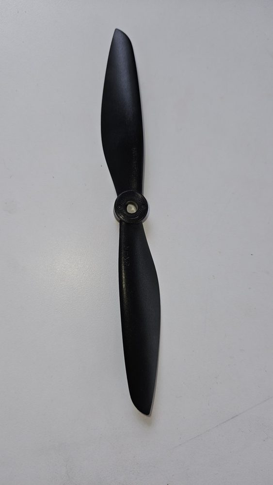
  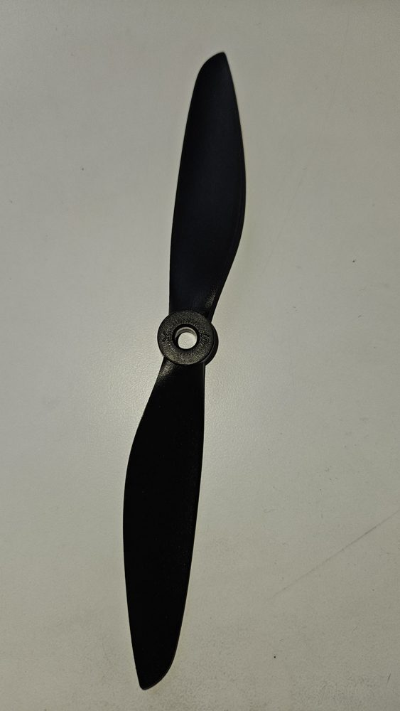
  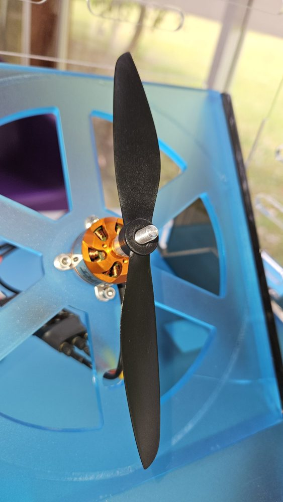
  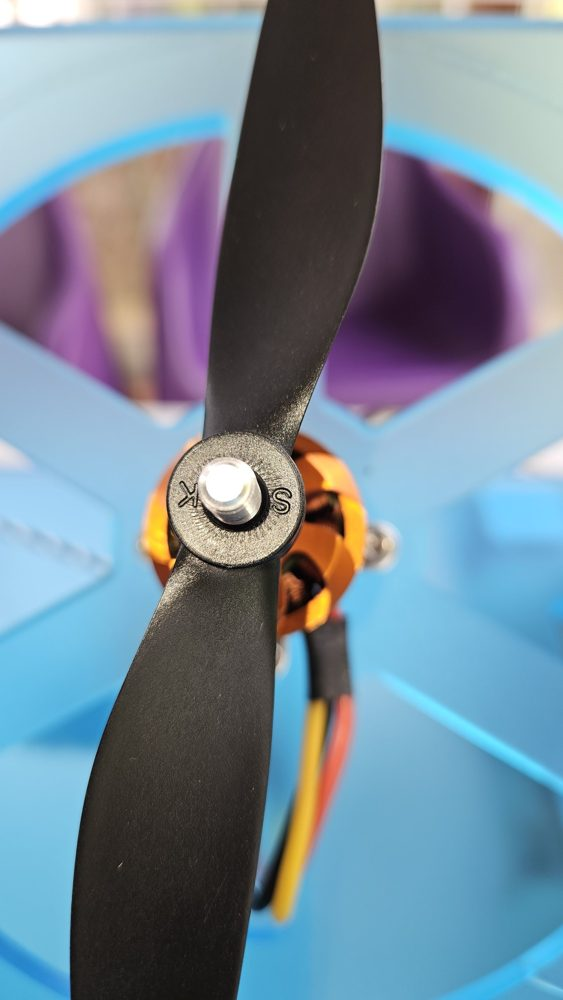
</p>

1. Como en un dron que despega, la hélice empuja el aire hacia el «piso»: aquí el piso es la **lámina**. Monta la hélice de modo que la cara que en un dron miraría al piso mire hacia la lámina.
2. Con `u ≈ 20 %`, comprueba con una tira de papel (nunca con la mano) que el aire vaya hacia la lámina.
3. Si va al revés: `u = 0`, apaga la fuente e **intercambia dos de los tres cables** entre el ESC y el motor.

## 5. Calibración del sensor y cómo usarla en Simulink

1. Con el motor **apagado**, lleva la lámina a 0, 10, …, 90° (subiendo y bajando) y anota la salida `adc`. Anota también 15, 45 y 75° para validar.
   Si el indicador del módulo no se lee bien, mide el ángulo con una app de nivel o inclinómetro en el celular, apoyada contra la lámina (manual, sección 6).
2. Copia las lecturas en la sección `DATOS` de [`scripts/calibracion_sensor.m`](scripts/calibracion_sensor.m) y ejecútalo.
   - El guion escoge la recta si su error máximo es menor a 1°, y si no la cuadrática.
   - Grafica los ajustes y el error en cada marca.
   - Guarda `a2`, `a1` y `a0` en **`cal_MPAxx.mat`**, con `y = a2·n² + a1·n + a0` (`a2 = 0` si el ajuste es lineal).
3. Arma la calibración en Simulink, a la salida `adc` del subsistema. En los bloques **Gain** y **Constant** se escribe el *nombre* (`a2`, `a1`, `a0`), no el número:

<p align="center">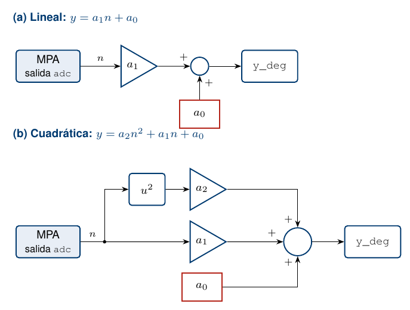</p>

4. Para que el modelo cargue la calibración sola, entra a **Modeling → Model Settings (flecha) → Model Properties → Callbacks → InitFcn** y escribe:
   ```matlab
   load('cal_MPA04.mat')   % con el número de tu módulo
   ```
   Si recalibras, basta con volver a correr el guion.
   Va en **InitFcn**, no en *PreLoadFcn*. *PreLoadFcn* solo corre al abrir el modelo, y cualquier `clear` posterior borra `a2`, `a1` y `a0`.

## 6. Mapa estático (ensayo en escalera)

Son dos guiones, como en la identificación:

- **[`programa_escalera.m`](scripts/programa_escalera.m), antes del Run:** borra los datos de una corrida anterior, define `uini`, `ufin`, `du` y `Th`, arma `u_prog` para el bloque *From Workspace* y fija el Stop time.
- **[`analisis_escalera.m`](scripts/analisis_escalera.m), después del Run:** con las variables del ensayo en el workspace,
  - revisa el enlace;
  - calcula el mapa θss(u) subiendo y bajando, la histéresis, `u_mov`, el `u` para 30/45/60° y la ganancia local K(u);
  - guarda todo en `mapa_MPAxx_fecha.mat`.

El guion espera estos nombres en el modelo:
- *From Workspace*: `u_prog`.
- *To Workspace* en formato **Array**, *Sample time* −1: `y_deg`, `u_ap`, `t_ard` y `latencia`.
- El tiempo sale del *To Workspace* `t` del *Clock* o de `tout`; si no hay ninguno, el guion lo arma con el paso de 0.02 s.
- Si los datos duran menos que el ensayo programado, el guion se detiene: la corrida se cortó o las variables son de otra corrida.

Así salió en la MPA 4: la curva es casi recta y sin histéresis entre 48 y 75 %, y por encima de unos 70° la lámina se vuelve inestable por la turbulencia. La lectura completa está en la sección 7 del manual.

<p align="center">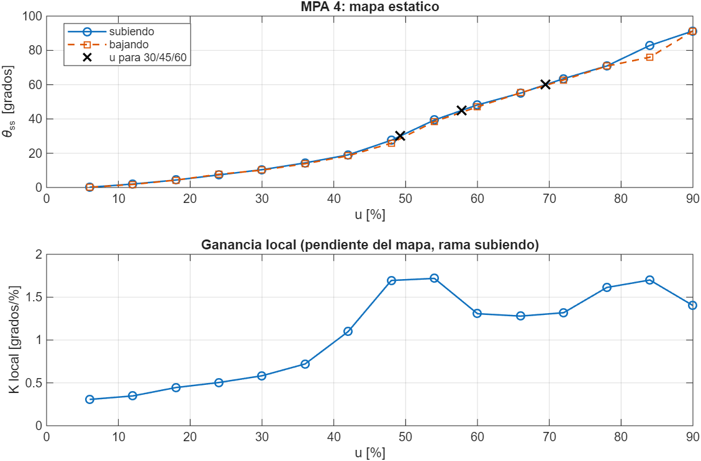</p>

## 7. Identificación en espacio de estados

Se identifican estados físicos, **x = [ángulo; velocidad angular]**, con tres números por punto de operación:

```
A = [0 1; -wn^2 -2*zeta*wn]     B = [0; K*wn^2]     C = [1 0]
```

1. `programa_identificacion.m` prepara la corrida: 3 pulsos y 2 escalones pequeños, unos 5 minutos.
2. `analisis_pulsos.m` saca ωn y ζ ajustando una cosenoide amortiguada a la respuesta libre después de cada pulso, y grafica cada ajuste.
3. `analisis_escalones_modelo.m` saca K del escalón de subida, arma A, B y C, estima el retardo y valida con el escalón de bajada.

Los *To Workspace* se sobrescriben en cada Run. Por eso `analisis_pulsos.m` guarda primero la corrida en `ident_MPAxx_fecha.mat`; para retomar otro día basta con `load`.

## Cómo funciona el enlace

- **El Arduino marca el reloj** (50 Hz), mide A0 (promedio de 16 lecturas) y aplica el pulso al ESC.
- **El mando pasa por una rampa y un tope.** La rampa de 50 %/s es un limitador de rapidez y debe ir también en el modelo simulado.
- **El Arduino reporta `u_ap`**, el mando aplicado de verdad. Es la señal de seguimiento para el anti-windup y la transferencia sin salto.
- **Seguridad:**
  - pulso de armado desde que el Arduino arranca;
  - PARO por software;
  - rearme solo con `u < 1 %`;
  - watchdog de 200 ms;
  - tope de pulso;
  - CRC-16 en los dos sentidos.

| Trama | Bytes | Contenido |
|---|---|---|
| Arduino → PC | 22 | `AA BB · seq u16 · t_ms u32 · adc f32 · u_ap f32 · ack u16 · flags u8 · versión u8 · crc16` |
| PC → Arduino | 11 | `CC DD · seq u16 · u f32 · flags u8 · crc16` |

CRC-16/CCITT-FALSE (polinomio 0x1021, inicial 0xFFFF), little-endian.

## Pruebas sin hardware

```bash
cd pruebas
g++ -std=c++11 -O1 -fPIC -shared -Imock -o libfw.so shim.cpp
python3 prueba_protocolo.py     # firmware + protocolo con fallas inyectadas
python3 fuzz_parser.py          # 16 000 fallas: ningún paquete corrupto entregado
```

## Créditos

- Prof. Sergio Andrés Castaño Giraldo — Universidad EIA.
- Módulo original: C. Barco Díaz y M. Sánchez Monsalve, *Módulo de control de posición angular: manual de uso*, EIA, 2016.
- El enlace serial sigue el esquema usado con la bomba de infusión del curso de Biomecatrónica (2026-1).
